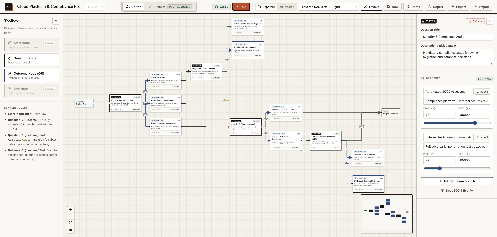

# MC Finance Modeller

An interactive Monte Carlo simulation and decision-tree (DAG) web application for project finance and budget estimation under uncertainty.

>[Access it here!](https://lgdan.github.io/mcfm/)

Built with **React 19**, **TypeScript**, **XYFlow (`@xyflow/react`)**, and **Zustand**.



---

## Overview

When scoping complex engineering or transformation programmes, requirements are rarely fixed upfront. Instead, delivery paths depend on chains of conditional *"what if"* questions, each with mutually exclusive outcomes, likelihoods, and cost impacts.

**MC Finance Modeller** lets you map those uncertainties visually as a Directed Acyclic Graph (DAG) and run thousands of Monte Carlo random walks across the decision network to determine a defensible **P80 project budget** (the budget level sufficient to cover 80% of simulated project outcomes), along with full percentile distributions and cost-driver sensitivity rankings.

---

## Key Features

### 1. Visual Decision DAG Editor
- **Node Types**:
  - **Start Node**: Single entry point for the project model.
  - **Question Node**: Represents a decision or risk point with mutually exclusive outcomes whose probabilities sum to `100%`.
  - **Outcome Node (`OR`)**: Represents a specific branch with a configurable probability (`%`), fixed cost impact, and assumptions description.
  - **End Node**: Explicit terminal leaf for completed pathways.
- **Flexible Routing & Mutual Exclusion**:
  - **Outcome-Level Routing (`Outcome → Question / End`)**: Route individual outcomes down different follow-up questions or straight to completion.
  - **Aggregate Question Routing (`Question → Question / End`)**: Connect a Question node's output directly to another Question (`ALL →`) or to `End` when all of its outcomes share the same downstream continuation. Connecting a Question's aggregate output automatically locks its individual outcome connectors (and vice versa).
- **Separate vs. Nested Outcome Views**:
  - Toggle between **Separate** (outcomes as standalone canvas nodes) and **Nested** (outcomes embedded as child cards inside their parent Question node) at any time.
- **Probability-Scaled Edge Widths & Auto-Balancing Sliders**:
  - Connection line thickness dynamically scales with branch probability (`0%` to `100%`).
  - Dragging a probability slider in the inspector automatically rebalances sibling outcome probabilities proportionally to maintain `100%`, while typing numbers into the input field remains manual.
- **Five Auto-Layout Algorithms**:
  - *Layered DAG (Left → Right)*, *Decision Tree (Subtree Balanced)*, *Compact Swimlanes*, *Top → Bottom Hierarchy*, and *Radial Concentric Rings*.
- **Full Diagramming Ergonomics**:
  - Multi-select marquee drag and `Shift`/`Cmd`+click, right-click context menu (`Cut`, `Copy`, `Paste`, `Duplicate`, `Delete`, quick-add nodes), keyboard shortcuts (`⌘C`, `⌘X`, `⌘V`, `⌘D`, `⌘A`, `⌫`), and collapsible **Toolbox** and **Properties** sidebars.

### 2. Monte Carlo Simulation Engine & Results Tab
- **Fast Client-Side Sampling**:
  - Simulates `1,000`, `10,000`, or `50,000` trials across the compiled DAG (with per-trial visited guards so diamond convergence is evaluated accurately).
- **Percentile & Contingency Metrics**:
  - Highlights the recommended **P80 Budget**, alongside **P50 (Median)**, **Expected Mean**, **Standard Deviation**, **P10**, **P90**, **P95**, and observed **Min – Max** range.
- **Interactive Distribution Histogram & CDF Curve**:
  - Visualizes cost buckets below and above the P80 threshold with a cumulative probability overlay and hover readouts.
- **Cost Drivers & Pathway Sensitivity Table**:
  - Ranks every question and outcome branch by its empirical trigger rate and expected contribution to total project cost.

### 3. Multi-Format Report Generator & Persistence
- **Report Exports**:
  - **Standalone HTML Report (`.html`)**: Self-contained actuarial dossier with embedded SVG histogram and tables.
  - **Printable / Save as PDF**: Opens a print-styled report view ready for browser *Save as PDF*.
  - **Markdown Report (`.md`)**: Executive summary, percentile tables, and DAG specification for GitHub, Notion, or Confluence.
  - **Spreadsheet Export (`.csv`)**: Summary percentiles, cost drivers, and histogram bin data for Excel or Google Sheets.
- **Local Persistence & JSON Portability**:
  - Automatically saves your working draft to `localStorage` and supports full `.json` model export and import.
- **Multi-Currency Support**:
  - Switch between `£ GBP` (default), `$ USD`, `€ EUR`, `A$ AUD`, `C$ CAD`, and `¥ JPY`.

---

## Running with Docker (Recommended)

Build and run the development server in a container on [http://localhost:5173](http://localhost:5173):

```bash
docker compose up --build -d
```

Useful Docker commands:

```bash
# View container logs
docker compose logs -f

# Run a production TypeScript + Vite build check inside the container
docker compose exec app npm run build

# Stop the container
docker compose down
```

---

## Running Locally (Node.js 22+)

```bash
npm install
npm run dev
```

To build the static production bundle into `./dist`:

```bash
npm run build
npm run preview
```

---

## Deployment (GitHub Pages)

This repository includes a GitHub Actions workflow ([`.github/workflows/deploy-pages.yml`](./.github/workflows/deploy-pages.yml)) that automatically builds and deploys the static site to **GitHub Pages** on pushes to `main` or `master`.

To enable it on GitHub:
1. Go to your repository **Settings → Pages**.
2. Under **Build and deployment**, set **Source** to **GitHub Actions**.
